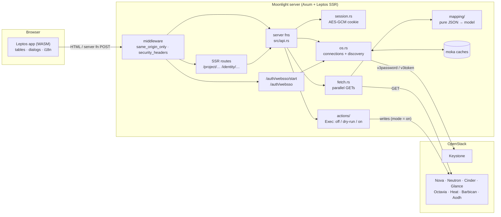
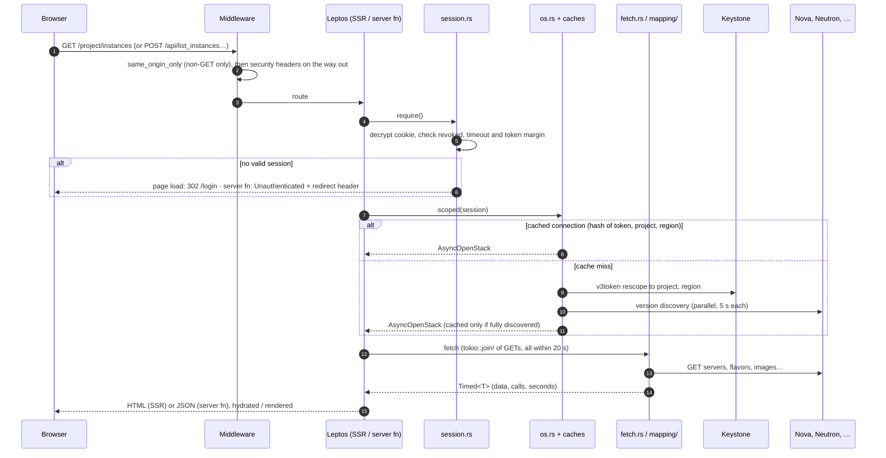
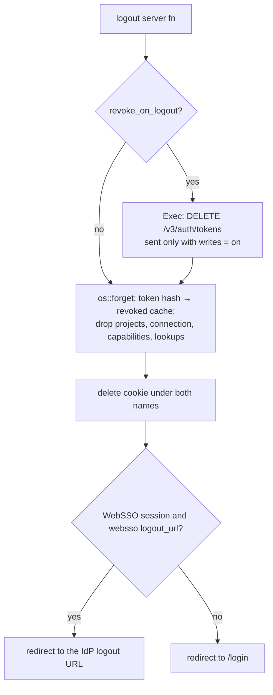
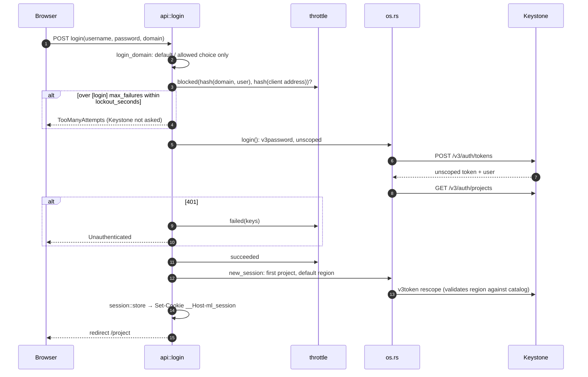
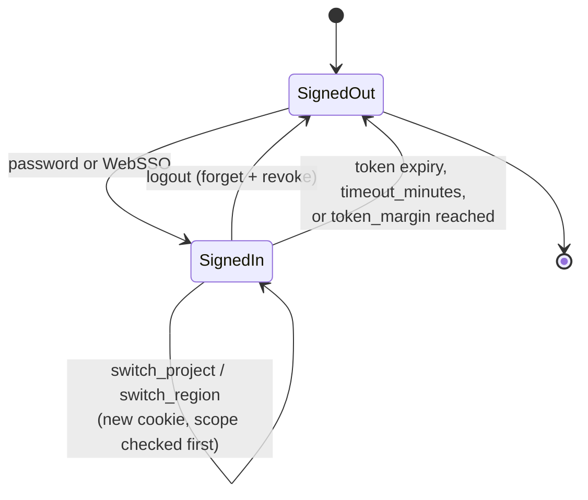
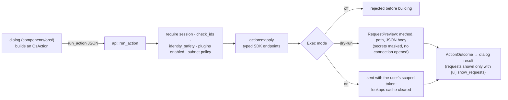

# Moonlight architecture

How Moonlight is built and why. [README.md](README.md) says what it is and how to run it,
[CONFIGURATION.md](CONFIGURATION.md) lists every setting, and [AGENTS.md](AGENTS.md) holds the
working rules and gotchas for changing the code. Roadmap numbers (`roadmap 49`) refer to
[ROADMAP.md](ROADMAP.md).

- [Design principles](#design-principles)
- [System overview](#system-overview)
- [Modules](#modules)
- [Request lifecycle](#request-lifecycle)
- [Session and cookies](#session-and-cookies)
- [Authentication flows](#authentication-flows)
- [OpenStack connections](#openstack-connections)
- [Reads](#reads)
- [Writes](#writes)
- [Capabilities and plugins](#capabilities-and-plugins)
- [Web security](#web-security)
- [In-process caches](#in-process-caches)
- [Front-end](#front-end)
- [Configuration and logging](#configuration-and-logging)
- [Testing strategy](#testing-strategy)

## Design principles

1. **Stateless server.** Everything needed to serve a user travels in an encrypted cookie.
   The in-process caches only save Keystone round-trips and can be dropped at any time, so any
   replica can serve any request.
2. **The user's own token, always.** Moonlight has no service account. Every OpenStack call
   is made with the signed-in user's token, rescoped to their project, so Keystone and service
   policies decide what is allowed, exactly as with the CLI.
3. **Writes are enforced on the server.** One write path (`OsAction` → `actions::apply` →
   `Exec`) obeys `[writes] mode = off | dry-run | on`. The UI only reflects the mode; it never
   is the gate.
4. **Reads are GET only.** `server/fetch.rs` never calls an endpoint with side effects. The
   few read-only POSTs (instance log/console, Heat validate/preview) go through `Exec` like
   writes.
5. **No N+1.** A page makes a handful of bulk list calls in parallel (`tokio::join!`) and
   joins them in memory with pure functions. Instances = servers + flavors + images: three
   calls, whatever the number of VMs.
6. **Pure mapping, tested without a network.** Raw JSON → model conversion lives in
   `server/mapping/` (one file per service), with no I/O, and is unit-tested with API-shaped payloads.
7. **Secrets never persist.** Tokens are never logged or written to disk (the SDK's auth
   cache is disabled), cache keys are SHA-256 hashes, `Debug` impls mask tokens and keys.
8. **Horizon's information architecture, better controls.** Same dashboards, panels, tabs
   and breadcrumbs; modern tables, dialogs, and an English/Spanish UI checked at compile time.
9. **Capabilities over assumptions.** Panels and actions declare what they need (a service,
   a microversion, a Neutron extension); what the cloud offers is detected per project and
   region. Unknown capabilities show everything rather than hide.

## System overview



The same Rust crate compiles twice: with the `ssr` feature into the server binary
(`src/main.rs`), and with `hydrate` into the WASM bundle (`src/lib.rs::hydrate`). Pages are
rendered completely on the server (`SsrMode::Async`), then hydrated; after that, navigation
and data loads happen in the browser through server functions.

## Modules

```text
src/
├── main.rs            Axum entry point: settings, logging, router, middleware (ssr)
├── lib.rs             crate root; WASM entry point `hydrate` (hydrate)
├── app.rs             HTML shell and routes (/login, /project/…, /identity/…)
├── api.rs             #[server] functions: the only browser ↔ server boundary
├── model/             DTOs, one file per service; mod.rs: Capabilities, needs, AppError,
│                      paging; action.rs: OsAction (every write); choice.rs: ChoiceSet
├── i18n.rs            translations! table (EN + ES), language detection, formatting
├── prefs.rs           deployment preferences shared with the browser (serde defaults)
├── theme.rs           light / dark / system theme
├── server/            server only (#[cfg(feature = "ssr")])
│   ├── settings.rs    layered moonlight.conf + MOONLIGHT_* → Settings
│   ├── config.rs      validated Config, process-wide AppState and caches
│   ├── session.rs     encrypted session cookie, require(), client address
│   ├── websso.rs      Keystone federation: start redirect, token callback, nonce
│   ├── throttle.rs    failed sign-in counting per username and address
│   ├── os.rs          login, rescoping, discovery, capabilities, catalog
│   ├── fetch.rs       GET-only data loading, lookups cache, call counting
│   ├── mapping/       pure JSON → model mappers, one file per service
│   ├── actions/       OsAction → typed SDK endpoints, one file per service; mod.rs:
│   │                  Exec and `apply` (one arm per variant, calling the service's fn)
│   ├── console.rs     instance Log / Console (read-only Nova POSTs, via Exec)
│   ├── heat.rs        Heat validate / preview (read-only POSTs, via Exec)
│   ├── upload.rs      image file upload: streamed proxy route, direct-mode ticket
│   ├── downloads.rs   openrc and clouds.yaml from Jinja templates
│   ├── errors.rs      SDK error text → classified AppError
│   ├── logging.rs     stdout and/or rotated file, text or JSON
│   └── templates/     built-in openrc / clouds.yaml templates
├── components/        layout, nav model, DataTable, dialog engine, ops (per-resource
│                      actions), pickers, topology geometry and canvas
└── pages/             one module per panel family (instances, lists, details, identity,
                       stacks, load balancers, key manager, topology, quotas, …)
style/main.css         theme tokens (light-dark()), layout
```

Dependencies point one way: `pages` → `components` → `api` (stubs in the browser) →
`server::*` (on the server) → `openstack_sdk`. `model`, `i18n` and `prefs` are shared by
both sides and contain no I/O.

## Request lifecycle

A page load and a later data load follow the same server path; only the transport differs.



Every data server function wraps its body in `api::scoped` (or `scoped_id`, which first
validates an ID taken from the URL, since IDs end up unencoded in request paths, roadmap 48).
`scoped` provides the session and connection, enforces `os::REQUEST_TIMEOUT` (20 s; the SDK's
HTTP client has none), counts the GETs for the table's `3 API · 0.41 s` chip, and enables the
per-scope lookups cache.

## Session and cookies

### What the session holds

The session is a JSON `Session` (`server/session.rs`) encrypted with AES-GCM through the
`cookie` crate's private jar:

| Field                          | Purpose                                                              |
| ------------------------------ | -------------------------------------------------------------------- |
| `token`                        | the **unscoped** Keystone token; rescoped per request, never logged  |
| `expires_at`                   | the token's expiry                                                   |
| `logged_in_at`                 | start of the sign-in; `[session] timeout_minutes` counts from here   |
| `user_id`, `user`, `domain`    | who signed in                                                        |
| `project_id`, `project_name`   | the current project (switcher)                                       |
| `region`                       | the current region (switcher); validated against the catalog         |
| `password_expires_at`          | for the password expiry warning                                      |
| `domain_context`               | Identity › Domains *Set Domain Context*                              |
| `websso`                       | identity provider and protocol of a federated sign-in, else `None`   |

Keeping the unscoped token (rather than a scoped one) lets the server rescope to any of the
user's projects without asking for credentials again. Switching project or region rewrites
the cookie; it does not touch Keystone beyond checking that the new scope works.

### Cookies

| Cookie                                | Content                                  | Attributes                                                   |
| ------------------------------------- | ---------------------------------------- | ------------------------------------------------------------ |
| `__Host-ml_session` (or `ml_session`) | encrypted `Session`                      | `HttpOnly`, `SameSite=Lax`, `Path=/`, `Secure` when `__Host-` |
| `__Host-ml_sso`                       | encrypted WebSSO nonce (expiry, choice)  | `HttpOnly`, `SameSite=None`, `Secure`, 10 min, one use       |
| `ml_lang`                             | the chosen language                      | set from the page by the language menu; `SameSite=Lax`, 1 year |
| `ml_theme`                            | `light` / `dark` (absent = system)       | set from the page by the theme menu; `SameSite=Lax`, 1 year  |

- **Name.** With `[session] secure_cookies = true` (the default) the session cookie is
  `__Host-ml_session`: the browser accepts it only with `Secure`, `Path=/` and no `Domain`,
  so a sibling subdomain cannot plant or overwrite it (roadmap 49). Plain-HTTP development
  uses `ml_session`. Both names are read, so flipping the setting signs nobody out; the name
  is part of the AES-GCM associated data, so each decrypts only under its own name.
- **Key.** `[session] cookie_key` is base64 of at least 64 bytes. Without it a random key is
  generated at start-up and every restart signs everybody out. All replicas must share it.
- **Lifetime.** `Max-Age` is `Session::ends_at` = the earlier of the token's expiry and
  `logged_in_at + timeout_minutes`. `require()` also treats a token within
  `token_margin_seconds` of expiry as expired, so a request never starts with a dying token.
- **Size.** Browsers silently drop cookies over 4096 bytes. Federated tokens can carry many
  group IDs, so the WebSSO callback checks `fits_in_a_cookie` and refuses the sign-in with a
  logged reason rather than looping back to `/login`.
- **Tampering.** A cookie that does not decrypt is simply no session; `why_not_signed_in`
  logs which case it was (no cookie, wrong key, logged out, expired), never the token.

### Logout and revocation



The `revoked` cache makes a copied cookie useless at once on that replica, even in dry-run
where Keystone is not told. With several replicas, Keystone's revocation covers the rest.

## Authentication flows

### Password sign-in



The password is used once and dropped (`SecretString`); only the token is kept. Throttling is
per process and counts only rejected credentials, not an unreachable Keystone (roadmap 50).

### WebSSO (Keystone federation)

Enabled with `[websso]`, as Horizon's `WEBSSO_ENABLED`. The identity provider's protocol (OIDC,
SAML) is handled entirely by Keystone's Apache; Moonlight only receives an unscoped token.

```mermaid
sequenceDiagram
    autonumber
    participant B as Browser
    participant M as Moonlight
    participant K as Keystone
    participant I as Identity provider

    B->>M: GET /auth/websso/start?choice=oidc
    M->>M: choice must be a configured protocol
    M-->>B: 303 to Keystone websso URL (origin=public_url/auth/websso)<br/>Set-Cookie __Host-ml_sso (encrypted nonce, 10 min)
    B->>K: GET /v3/auth/OS-FEDERATION/…/websso?origin=…
    K->>I: redirect: OIDC / SAML login
    I-->>K: assertion
    K-->>B: auto-submitting form with the unscoped token
    B->>M: POST /auth/websso (token) + nonce cookie, Origin = Keystone or null
    M->>M: nonce decrypts, unexpired, never used (websso_used)<br/>Origin is Keystone's or null
    M->>K: v3token (unscoped): validates the token, returns a new one
    M->>K: GET /v3/auth/projects, rescope
    M->>M: session.websso = {idp, protocol}; check it fits in a cookie
    M-->>B: 303 /project<br/>Set-Cookie session + delete nonce
```

Design points:

- The callback is a **cross-site POST**, so it is the one route `same_origin_only` lets
  through. It defends against login CSRF (an attacker posting their own token) with the
  nonce: only the browser that started the flow can finish it, and only once.
- Keystone checks `origin` by exact string against `[federation] trusted_dashboard`, so the
  nonce cannot travel in the URL; it lives in a `SameSite=None` cookie, which comes back on
  the cross-site POST.
- The session cookie is set in the response to that POST. Browsers keep `SameSite=Lax`
  cookies from a top-level navigation's response and send them on the following `303`.
- Both `Set-Cookie` headers use `AppendHeaders`: an array of tuples *inserts*, and the nonce
  removal used to replace the session cookie (roadmap 80).
- Failures return to `/login?sso=expired|failed|noprojects`, which the login page explains.
  The token is never logged; there is no throttling because no password reaches Moonlight.

### Session expiry and project or region switch



`get_session_info` also repairs a session whose region left the catalog by switching to the
first available region and telling the UI (`region_fallback`).

## OpenStack connections

All OpenStack access goes through gtema's `openstack_sdk` (`server/os.rs`):

- **Login** uses `v3password` (or `v3token` for WebSSO), unscoped. The projects list is cached
  under `sha256(token)` for 5 minutes.
- **Every request** needs a connection scoped to the session's project and region: `v3token`
  with `project_id`, cached in `connections` under `sha256(token, project, region)` with a
  15-minute idle time. Losing the cache costs one Keystone call.
- **Version discovery** (`discover_service_endpoint`) runs once per new connection for
  compute, network, block-storage, image and load-balancer, in parallel with a 5 s bound each,
  because catalogs often list unversioned endpoints (`https://neutron…/`). A connection is
  cached only when the core four were discovered, so a region that was down recovers on the
  next request.
- **Never on disk.** Every `CloudConfig` has `auth_cache: Some(false)` and the builder
  `.disable_auth_cache(true)` and `.renew_auth(false)`.
- **Timeouts.** Each server function is bounded by 20 s (`REQUEST_TIMEOUT`); the boxed future
  in `os::within` also keeps debug builds within the 16 MiB worker stack (`main.rs`).

## Reads

`server/fetch.rs` is GET only. A loader:

1. issues the independent list calls in parallel (`tokio::join!`, or `spawn_counted` into a
   `JoinSet` for fan-outs), through the `list_all!` / `list_where!` / `get_one!` macros that
   count calls; the list macros ask for 1000 rows a page (`LIST_PAGE`) and fail with
   `ErrorKind::TooLarge` past `[ui] max_list_items` rather than show a cut list (roadmap 104);
2. wraps lists that only supply names in `soft()`, so a failing lookup degrades to IDs instead
   of failing the page;
3. reuses name-only lists (flavors, images, networks, volumes…) from the `lookups` cache for
   `[cache] lookup_seconds`, keyed per token, project and region (roadmap 66); concurrent
   misses on one key share one fetch (moka `try_get_with`);
4. hands the raw JSON to `mapping` and returns `Timed<T>` (data, call count, seconds).

OpenStack quirks are handled once, here and in the mappers: admins see every project's Neutron
resources, so lists filter by `tenant_id`; networks are own + shared + external, merged by
ID; Cinder's `bootable` is a string; `-1` quotas mean unlimited.

## Writes



- `OsAction` (`model/action.rs`) enumerates every mutation. Multi-step actions (network + subnet)
  chain IDs; in dry-run the IDs are placeholders such as `<new network id>`.
- Dry-run builds requests with the **same typed endpoints** as `on`, which is why every
  action is tested in dry-run, asserting method, path and exact JSON body.
- Every write is logged with user, project, client address, mode, request count and action
  kind: no IDs, names or secrets.
- Read-only POSTs (`console.rs`, `heat.rs`) and token revocation reuse `Exec`, so they too are
  only sent with `mode = on` (and the console also needs `[console] enabled`).

## Capabilities and plugins

`os::capabilities` detects, per project and region (cached 10 minutes): catalog services,
Neutron extensions and the highest compute and volume microversions. Panels declare
`requires` in `components/nav.rs`; actions check constants from `model::needs`
(`needs::REBUILD.met(&caps())`). If detection fails, `known: false` makes every check pass,
so the UI never hides features by mistake.

Horizon plugin panels (Octavia, Heat, Barbican, Aodh…) are opt-in through `[plugins] enabled`:
`Requires::Plugin` does not fail open, and their server functions check `plugin_enabled`
too, so disabling a plugin also closes its API.

## Web security

[SECURITY.md](SECURITY.md) covers the threat model, every measure with its limits, the accepted
risks and the deployment checklist. The browser-facing ones, in short:

| Measure                                       | Where                                                                  |
| --------------------------------------------- | ---------------------------------------------------------------------- |
| Same-origin check on every non-GET request    | `server::same_origin_only`: `Sec-Fetch-Site`, else `Origin` vs `[session] public_url` or `Host` (roadmap 48) |
| Clickjacking, sniffing, referrer, plugins     | `server::security_headers`: `X-Frame-Options: DENY`, CSP `frame-ancestors 'none'; object-src 'none'; base-uri 'self'`, `nosniff`, `Referrer-Policy: same-origin` |
| HSTS                                          | one year, when `secure_cookies` (HTTPS)                                |
| IDs pasted into request paths                 | `check_id` / `OsAction::check_ids` (roadmap 48, 67)                    |
| Sign-in brute force                           | `throttle.rs` per username hash and client address hash               |
| Client address behind proxies                 | `[log] client_ip_header` + `trusted_proxies` (counted from the right)  |
| Error detail leakage                          | `sfe` → `errors::public`: full SDK text only with `[ui] show_error_details` |
| Secrets in previews                           | `mask_secrets`, `hide_params` in `actions/mod.rs`                 |

## In-process caches

All `moka` caches live in `config::AppState`; keys are SHA-256 hashes, so no token, username
or address is ever a key.

| Cache          | Key                              | Lifetime          | Holds                                         |
| -------------- | -------------------------------- | ----------------- | --------------------------------------------- |
| `connections`  | hash(token, project, region)     | 15 min idle       | scoped, discovered `AsyncOpenStack`           |
| `projects`     | hash(token)                      | 5 min             | projects of the unscoped token                |
| `capabilities` | hash(token, project, region)     | 10 min            | detected services, extensions, microversions  |
| `lookups`      | scope hash + `/` + list name     | `lookup_seconds`  | name-only lists; cleared after writes, logout |
| `revoked`      | hash(token)                      | 24 h              | tokens of sessions that logged out            |
| `websso_used`  | hash(nonce cookie value)         | nonce lifetime    | used WebSSO nonces (replay guard)             |
| login throttle | hash(domain, user), hash(addr)   | `lockout_seconds` | failed sign-in counts                         |

Losing any of them costs at most an extra Keystone or service round-trip, except `revoked`
and the throttle, whose per-process scope is documented in their modules.

## Front-end

- **Leptos 0.8**, SSR in `Async` mode plus hydration. Data comes from `Resource`s read inside
  `<Transition>`, keyed by the URL and a `data_version` signal that refresh buttons and
  successful writes bump.
- **`DataTable<T>`** (`components/table.rs`): generic, client-side filter and sort, Horizon's
  "Displaying N items", backend cost chip; columns are built outside `view!`.
- **Dialog engine** (`components/dialog.rs`): declarative fields, dynamic choices
  (`Source::Set`, `Switch`, `Of`), conditional visibility, destructive confirmations with a
  required "Yes, I understand", and the dry-run request view.
- **ops** (`components/ops/`, one file per service): what each resource can do, shared by
  list rows and detail headers.
- **i18n** (`i18n.rs`): each string declared once with English and Spanish; a missing
  translation does not compile. The language comes from `ml_lang`, else `Accept-Language`,
  computed identically on server and client so hydration matches.
- **Theme** (`theme.rs`): `ml_theme` rendered as `data-theme` on `<html>` during SSR (no
  flash); colours are `light-dark()` tokens on `:root`.
- **Topology** (`topo_layout.rs`, `topo_canvas.rs`): pure geometry, so server and browser draw
  the same picture.

## Configuration and logging

Settings are read once at start-up (`server/settings.rs`), layered like oslo.config: built-in
defaults, `--config-file` files (or the first default found), `--config-dir` / `moonlight.conf.d`
files by name, then `MOONLIGHT_*` variables. `config::init` validates them into `Config` and
fails start-up on any bad value. `prefs.rs` holds the subset the browser needs, sent with
`get_session_info`. Full reference: [CONFIGURATION.md](CONFIGURATION.md).

The listener is axum's plain HTTP unless `[server] tls_cert_file` and `tls_key_file` are set;
then `server/listen.rs` accepts TLS itself (rustls, hyper-util's HTTP/1.1 + HTTP/2 builder over
the same router). Its certificate resolver holds the current pair behind a lock, so a task can
re-read the files every minute and swap in a renewed, valid pair without rebuilding the TLS
configuration or restarting (roadmap 107): OpenShift's service CA renews the mounted Secret
without restarting pods.

Logging (`server/logging.rs`) goes to stdout and/or a rotated file, as text or JSON. Sign-ins,
logouts and writes are logged with user and client address; tokens never are, and the log file
is created without access for other users.

## Testing strategy

Tests sit next to the code (`#[cfg(test)]`) and need no cloud:

- `server::actions`: every `OsAction` in dry-run, asserting service, method, path and JSON
  body; `every_action_has_a_dry_run_test` and the path-parameter check (roadmap 67).
- `server::mapping`: joins with API-shaped JSON, including odd cases (no name, `""` vs `null`,
  string booleans, admin-visible resources).
- `server::session`, `websso`, `throttle`, `os`: encryption round-trips, tampering, cookie
  flags and size, nonce replay and origin checks, keys never containing secrets, auth cache
  disabled.
- `server` (middleware): same-origin rules and security headers.
- `components::*`, `i18n`: filtering, sorting, nav matching, form logic, translations
  complete.

Run them with `cargo nextest run --features ssr`; see [AGENTS.md](AGENTS.md) §2 for the full
check list (both clippy targets, Markdown lint).
